<div align="center">


# HostSpawn

**Set up, run and look after your game servers from one app.**
Pick a game, press Create, and HostSpawn downloads it, configures it, starts it and keeps it running.

**HostSpawn by TrixemTV** · free and open source (GPL-3.0)

**Ready:** Rust · Arma 3 (Vanilla, Altis Life) &nbsp;|&nbsp; **Coming soon:** Arma Reforger, more Arma 3 modes, the Windows app

Runs on a 64-bit Linux PC or server (Ubuntu 22.04+ / Debian 12+)

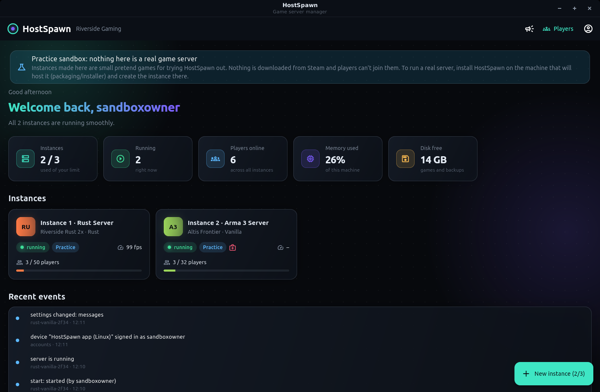

</div>

## Why HostSpawn
- **Runs on your own machine.** Your passwords, saves and player data never leave it. No tracking, no cloud
  account needed. The engine only listens on `127.0.0.1`.
- **Easy for anyone.** A step-by-step setup for each game, with guided steps for the bits you do yourself
  (opening ports, a Steam login), and plain-English messages throughout.
- **Looks after itself.** Health checks every minute, crash recovery, scheduled restarts with in-game
  countdowns, updates, wipes and daily backups.
- **Built to be trusted.** Free and open source. Python standard library only (nothing to `pip install`), every
  release file has checksums that Setup checks before installing, and every change is tested against fake servers
  before it ships. Only what has run on real servers is offered; the rest says "Coming soon". Build it yourself:
  [docs/BUILDING.md](docs/BUILDING.md).

## What it does
| | |
|---|---|
| **Instances** | Each game server is an *instance*: "Instance 1 · Rust Server", "Instance 2 · Arma 3 Server". Up to 3 per person. |
| **Create in minutes** | Choose a game, a server type and a map. HostSpawn does the download, config, passwords and first start. |
| **Players and moderation** | Who's online, everyone ever seen, playtime, notes, a watchlist, and **one ban list for every instance** (Rust; Arma 3 coming soon). |
| **In-game messages** | Restart countdowns ("Server restart in 5 minutes."), scheduled messages, and a message to every instance at once (Rust; Arma 3 coming soon). |
| **Schedules** | Restarts with updates, Rust wipes (map or full, blueprints). |
| **Installation** | Version and "Update available", safe updates (backup first, put back if it won't start), check and repair, reinstall keeping saves, clean up, history. |
| **Files editor** | Edit config and script files in the app (colours, find, go to line), checked before saving, 20 versions to go back to, Arma 3 missions packed into .pbo. |
| **Backups** | Daily, kept for as long as you choose, one click to back up now. |
| **PC check** | Tells you if this machine can run each game comfortably, with the reasons, before you create anything. |
| **Themes** | Aurora, Ember, Ocean, Forest and Royal. Each person picks their own. |
| **Team access** | Accounts with roles on your own machine: Admin, Moderator, Viewer. No sign-up with us. |
| **Bug reports** | Account menu → **Report a bug**: safe details, straight to GitHub. |

<table>
<tr>
<td width="50%">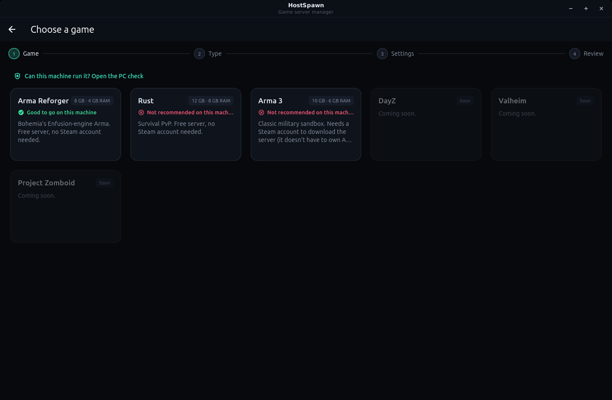<br><sub><b>New instance:</b> pick a game, then a type and map.</sub></td>
<td width="50%">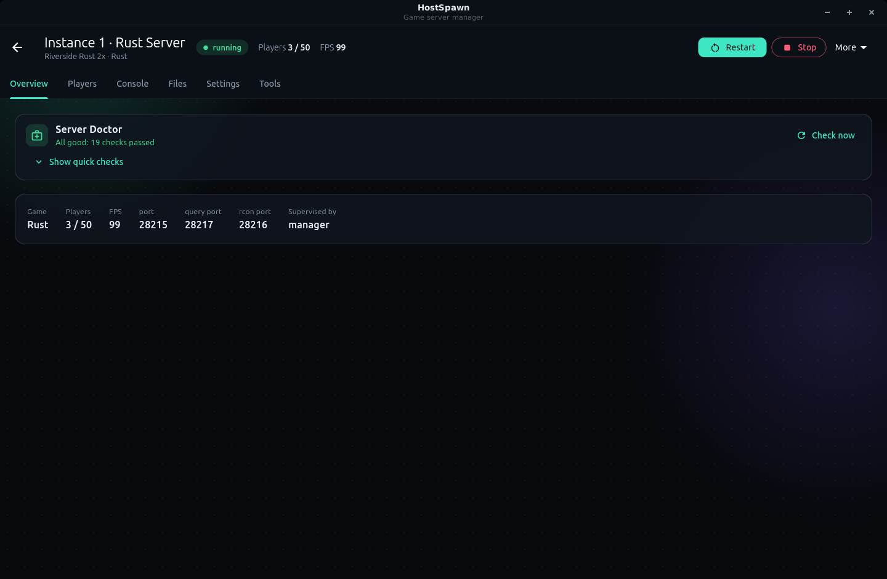<br><sub><b>Instance panel:</b> status and Start / Restart / Stop on every tab, Server Doctor first.</sub></td>
</tr>
<tr>
<td>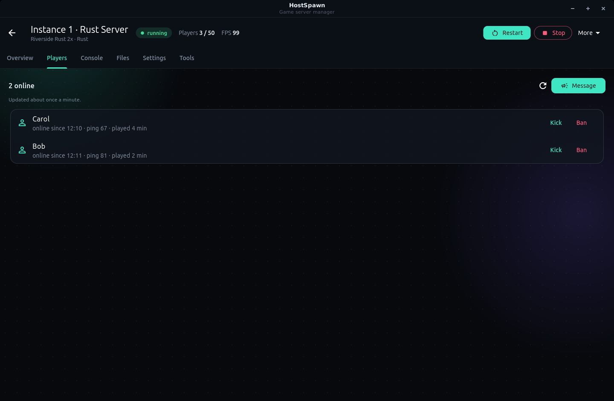<br><sub><b>Players:</b> who's on now, kick or ban in two clicks.</sub></td>
<td>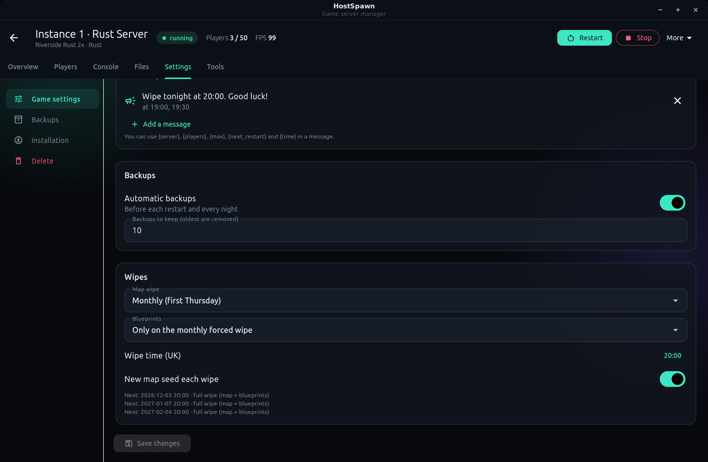<br><sub><b>In-game messages:</b> countdowns and scheduled messages.</sub></td>
</tr>
<tr>
<td>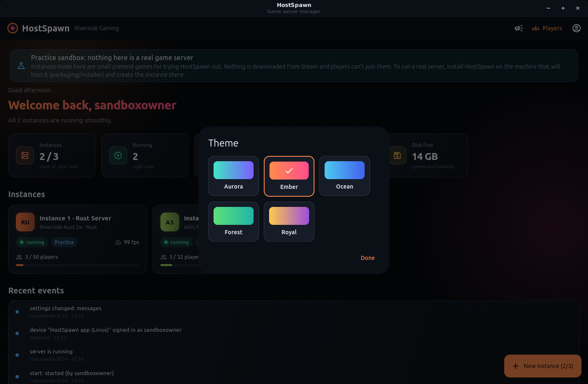<br><sub><b>Themes:</b> pick the colours you like.</sub></td>
<td>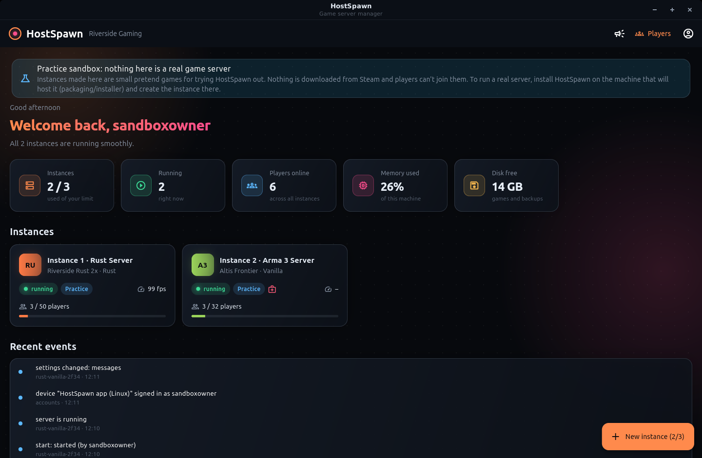<br><sub><b>Ember:</b> the same dashboard, warmer.</sub></td>
</tr>
<tr>
<td>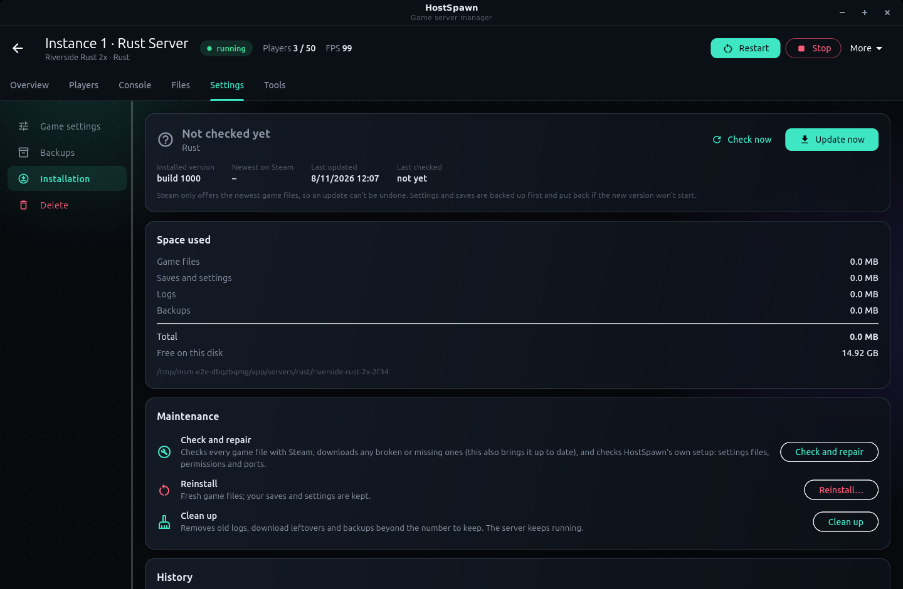<br><sub><b>Settings › Installation:</b> updates, repair, reinstall, clean up.</sub></td>
<td>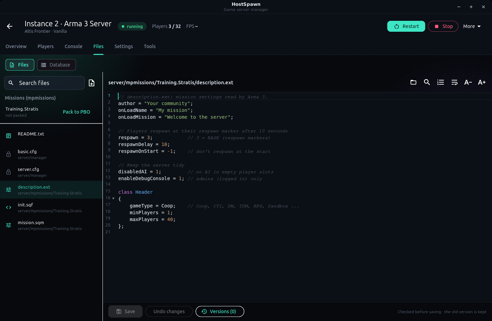<br><sub><b>Files:</b> edit configs and scripts, pack Arma 3 missions.</sub></td>
</tr>
<tr>
<td>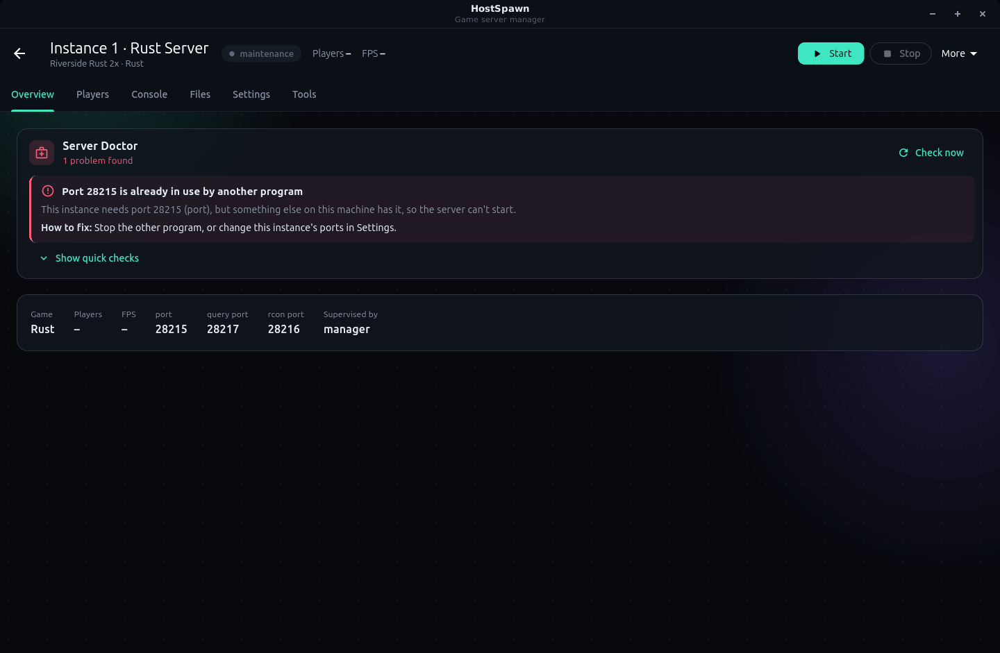<br><sub><b>Server Doctor:</b> what's wrong, in plain English, and how to fix it.</sub></td>
<td>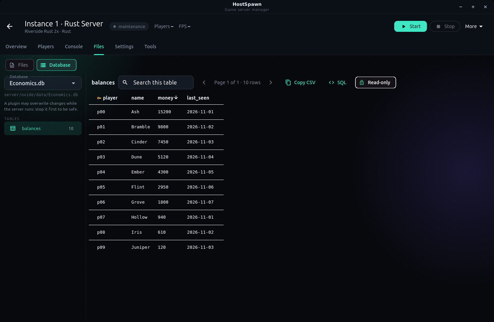<br><sub><b>Database:</b> browse, search and safely edit an instance's database.</sub></td>
</tr>
<tr>
<td>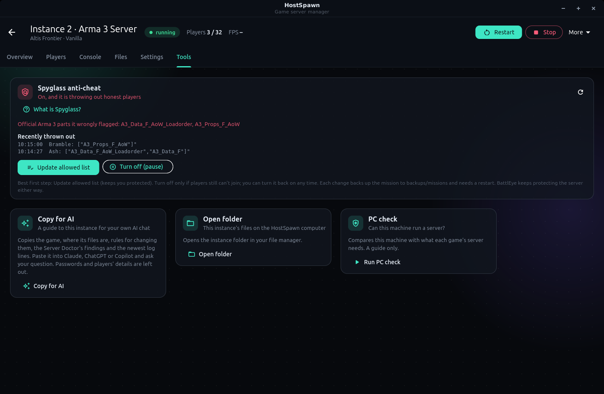<br><sub><b>Tools:</b> Spyglass (Altis Life), Copy for AI, Open folder, PC check.</sub></td>
<td></td>
</tr>
</table>

## Project layout
```
backend/          The engine (Python 3.11+, standard library only)
  manager/          supervisor, web API, setup jobs, player database, one adapter per game
  games/            per-game install scripts and config templates
  tests/            unit tests and sandboxes (fake games, fake SteamCMD, fake RCON: never real servers)
frontend/
  app/              the HostSpawn app (Flutter: Linux now, Windows and macOS next)
  setup/            HostSpawn Setup, the installer window (Flutter)
  web/              the built-in browser dashboard
packaging/        release builder, signing and verify scripts (release/), Linux installer and uninstaller, desktop launcher
website/          the HostSpawn website
docs/             user guide, developer guide, changelog, roadmap
config/           examples only; your real settings stay on your machine (git-ignored)
manager.sh        one command for everything: serve, status, start/stop, keepalive
```

## Quick start (development)
```bash
git clone <this repo> && cd Manager
./manager.sh init-secrets                            # makes config/secrets.env (private, chmod 600)
printf 'MODE=dev\nPORT=8101\n' > config/instance.env
./manager.sh serve                                   # http://127.0.0.1:8101 shows the setup wizard
```
The app: see [`frontend/app/README.md`](frontend/app/README.md). To try everything with fake servers and fake
players, run `python3 -I backend/tests/app_sandbox.py` and point the app at it.

## Tests
```bash
python3 -I -m unittest discover -s backend/tests -t backend     # engine
python3 -I backend/tests/e2e_sandbox.py                          # end to end, in a sandbox copy
(cd frontend/app && flutter test)                                # app
(cd frontend/setup && flutter test)                              # installer window
backend/tests/installer_sandbox.sh                               # installer, with a fake HOME
```
Tests only ever use fakes. They never touch a real game server.

## Documentation
- [User guide](docs/USER_GUIDE.md): creating instances, health checks, the CLI, Arma 3 notes
- [Files editor](docs/FILE_EDITOR.md): editing config and script files, versions, Arma 3 mission packing
- [Server Doctor](docs/SERVER_DOCTOR.md): how problems are found and fixed
- [AI help](docs/AI_HELP.md): Copy for AI and AGENTS.md, for using your own AI assistant safely
- [Database tab](docs/DATABASE.md): looking at and changing an instance's database safely
- [Developer guide](docs/DEVELOPERS.md): how it fits together, adding a game, the API
- [Changelog](docs/CHANGELOG.md) · [Roadmap](docs/ROADMAP.md) · [Contributing](CONTRIBUTING.md) · [Security](SECURITY.md)

## Community and help
Join the **[HostSpawn Discord](https://discord.gg/AaBwz8szM)** for updates, to suggest ideas, and to get help (press **Get help** in #help
for a private ticket).

## Security
Found a problem? Please report it privately to the maintainer rather than opening a public issue.
HostSpawn never asks for your passwords in chat or email, and never sends your data anywhere.

## Licence
HostSpawn by TrixemTV is free and open source under the **GNU GPL-3.0** with two extra terms (see `NOTICE`): keep the
"HostSpawn by TrixemTV" credit, and don't use the HostSpawn name or logo for a changed version
([TRADEMARKS.md](TRADEMARKS.md)). Contributions are welcome.
