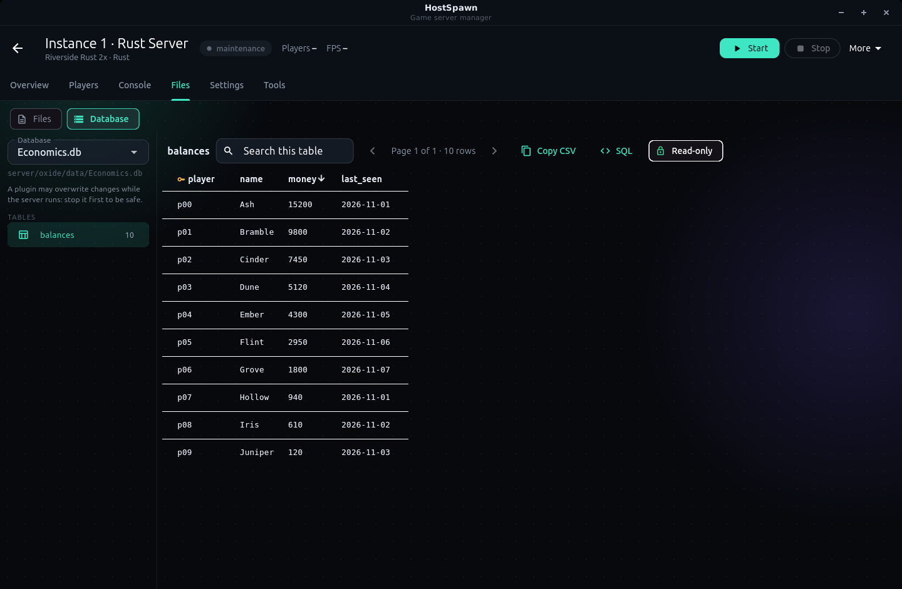

# The Database view

On an instance's **Files** tab, switch to **Database**. Look at an instance's database, and change it carefully, right in the HostSpawn app. You don't need any other
database program. **Admins only.**



## Which databases
Only the instance's own:
- **Altis Life (Arma 3):** its MariaDB database. HostSpawn opens it with the instance's own login file, so the
  database password never reaches the app.
- **SQLite files inside the instance's folder**, for example data that Rust plugins save in `oxide/data`.

Nothing else on the computer can be opened from here. That includes other instances, HostSpawn's own files and
other projects.

## Looking (always safe)
1. Open the instance → **Database**.
2. Pick the database (top left), then a table.
3. **Search** the table, click a column name to **sort** it (click again to reverse), and use the arrows for more
   pages (50 rows a page).
4. **SQL** opens a query box. Ready-made questions for Altis Life include *Richest players*, *Vehicles per player*,
   *Gangs* and *Seen this week*. **Run** answers read-only queries (`SELECT`, `SHOW`, `DESCRIBE`, `EXPLAIN`).
5. **Copy CSV** copies what's on screen, ready to paste into a spreadsheet.

The tab starts **Read-only**: nothing can change. A query that would change data is refused with an explanation.

## Changing (careful)
Turn on **Changes** (the lock at the top). Then you can:
- **edit a cell:** double-click it;
- **delete a row:** the bin at the end of the row;
- **run a changing query:** for example `UPDATE`, in the SQL box.

Every change:
1. asks you to type **CHANGE**;
2. **backs up the database first**, into the instance's `backups/database` folder (the last 10 backups are kept);
3. is written to the event log: who did it, what kind of change, and how many rows. The data itself is never
   logged.

**Tips:**
- **Altis Life:** players are saved while they play, so change money or items while the player is **offline**, or
  the game may write over your change.
- **Rust plugins:** a plugin may write over your change while the server runs. Stop the instance first to be safe.
- Rows can only be edited or deleted by clicking when the table has a **key column** (🔑). Without one, use a SQL
  query.
- One statement at a time, at most 500 rows shown, and 10 seconds per query.

## Undoing a change
Each change leaves a backup in `backups/database` (use **Open folder** on the instance's Tools tab):
- **SQLite:** stop the instance, then copy the backup over the original file (rename it back to its original name).
- **MariaDB:** the backup is a `.sql` file. Load it with
  ```bash
  mysql --defaults-extra-file=<instance>/manager/db.cnf <database name> < backups/database/<file>.sql
  ```
  while the server is stopped.
