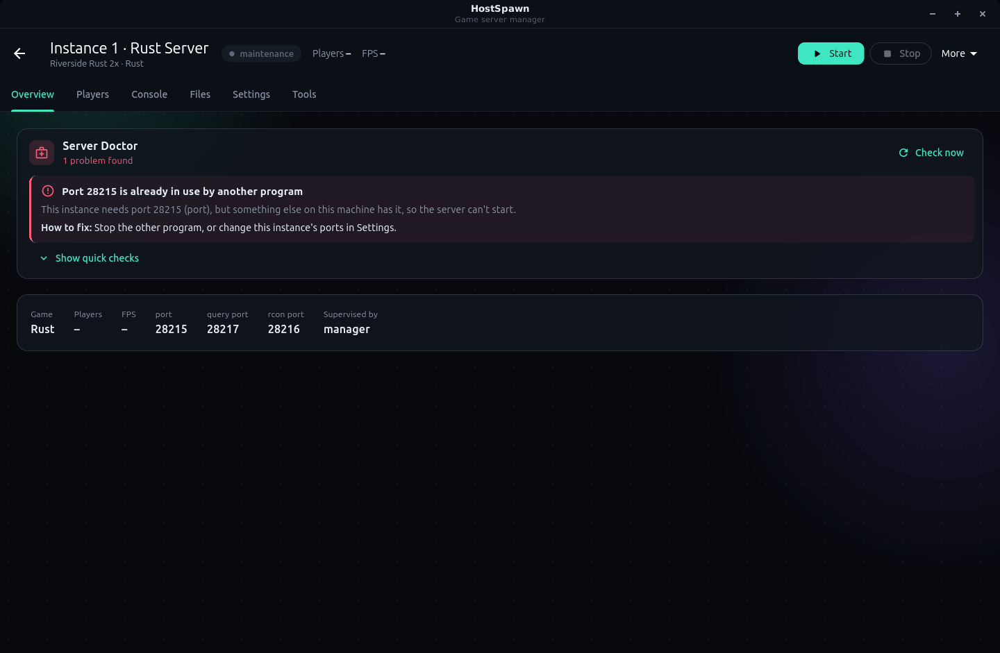

# Server Doctor

When a server crashes, won't start or acts strangely, the Server Doctor tells you **what's wrong, in plain English,
and how to fix it**. You don't have to read the logs yourself.

## Where to find it
- **Each instance's Overview tab**: the **Server Doctor** card. It checks when you open the instance and whenever the
  instance starts or stops. Press **Check now** to check again. **Show quick checks** lists the live
  checks (process, game queries, RCON, log, backup) that used to be a separate Health checks list.
- **After a crash**: the alert says why, for example *"Server Doctor: Port 28115 is already in use by another
  program"*.
- **The dashboard**: a red 🩺 badge on any instance with a problem. Hover over it to see the problem.

## What it looks at
- **The newest console log** (and the Steam update log, while an update is failing): it looks for about 25 known
  problems.
- **The instance's ports** (only while it's stopped): it checks whether another program has taken one.
- **This machine**: free disk space and free memory.
- **Crash history**: whether it gave up after crashing again and again, or restarted 3 or more times in an hour.

It only looks: checking never changes anything.

## What it can find (examples)
| Game | Problems |
|---|---|
| Any | port used by another program · disk full · out of memory · missing system library · file permission problem · crash inside the game · Steam login needed · Steam account can't download · update failed · game files missing |
| Rust | a plugin doesn't compile (names it) · a plugin doesn't start · RCON didn't start · map didn't load |
| Arma Reforger | a mod didn't download · `config.json` has a mistake · scenario not found · Bohemia's online service not answering |
| Arma 3 | BattlEye kicked a player · Spyglass (Altis Life's anti-cheat) threw out a player · Altis Life can't reach its database · mission file not found · a mod needs another mod · mod folder has capitals · BattlEye didn't start |

## Fix buttons
Where a fix is safe, the finding has a button. Every button asks you first.

| Button | What it does |
|---|---|
| **Repair** | Checks every game file and downloads any that are missing or broken. Your settings and saves are kept. |
| **Clean up** | Removes leftover download and temporary files. |
| **Update now** | Downloads the latest game server. |
| **Start / Restart** | The same as the buttons in the instance's top bar. |
| **Update Spyglass** | Altis Life only. Adds the official Arma 3 parts that Spyglass wrongly flagged to its allowed list (after backing up the mission). Then restart. To pause Spyglass instead, use the **Spyglass** button on the Spyglass card (Tools tab). |
| **Open Files / Database / PC check** | Takes you to the right place to fix it yourself. |

Moderators and viewers see the findings. Fix buttons that change something only show for people allowed to run
the instance.

## Altis Life: Spyglass
Altis Life comes with its own anti-cheat, **Spyglass**. When a player joins, it checks their game for cheat menus and
for game parts it doesn't know. Anyone suspicious sees **"The SpyGlass sees you!"** and is sent back to the menu.
Its list of allowed parts was last updated in 2019, and Arma 3 has had new parts since, so it can treat honest
players as cheaters.

Altis Life instances have a **Spyglass anti-cheat** card on the Tools tab (admins only). It shows whether
Spyglass is **on**, **paused** or **changed and waiting for a restart**, who it threw out lately, and which parts it
complained about.

**One Spyglass button** on the card opens the options (best first):
1. **Fix for this Arma 3.** Reads every official Arma 3 part (names starting with `A3_`) from the server's own game
   files and adds the ones Spyglass doesn't know, plus any official part it flagged, all in one go. You stay
   protected. (Fixing from kicks alone is slow: Arma cuts each log line at about 1,024 characters, so one kick only
   names about 30 parts.)
2. **Pause Spyglass (turn off).** Uses Altis Life's own switch (`spyGlass_toggle` in `config/Config_Master.hpp`),
   so Spyglass stops checking players. BattlEye keeps protecting the server.
3. **Turn Spyglass back on.** Shown while it's paused.

Press **Apply and restart** (or **Apply** when the instance is stopped). HostSpawn backs up the mission, makes the
change and applies it for you: a running instance restarts (players are disconnected for about a minute), and a
stopped one uses it the next time it starts. Changes only reach players after that restart, because Arma loads the
mission when it starts. **Doing it by hand** in the same box explains the manual way.

Turning it off is better than deleting the Spyglass files. Deleting them breaks parts of the mission that call it,
can't be undone with one click, and updates bring them back.

Every change asks you to confirm, backs up the mission to the instance's `backups/missions` folder first, and only
touches that one setting or list. Names that don't start with `A3_` are listed but never added for you: they're
mods or possibly cheats. If your server allows mods, add their names yourself to `_patchList` in
`SpyGlass/fn_initSpy.sqf` inside the mission.

## Good to know
- The Doctor knows common problems, not every problem. If it says **All good** and something still isn't right,
  look at the **Console** tab, or ask in the HostSpawn Discord.
- Its log patterns come from each game's known messages. If you see a problem it should have caught, tell us: new
  patterns are easy to add (`RULES` in `backend/manager/doctor.py`).
